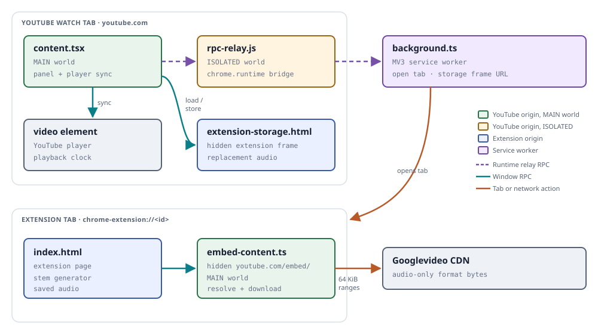

# Extension Architecture

Stem Mixer for YouTube is one Manifest V3 extension with two workflows. On a YouTube watch page, it plays replacement audio in sync with the video. In an extension tab, it acquires source audio from YouTube or a local file and separates it into stems with Demucs.

## Split the Extension by Browser Capability

Each context exists because Chrome gives it a different set of capabilities, so each one holds only the work that needs those capabilities.

- The watch page's MAIN-world script can read YouTube's player and DOM, but it cannot use extension APIs. It holds all watch-page product logic: the panel, the mixer, and playback sync.
- The watch page's ISOLATED-world script shares the same frame and can use `chrome.runtime`. It holds no product logic and only relays messages between the MAIN world and the service worker. The MAIN world reaches it with `window.postMessage` inside the frame, so messages never cross tabs.
- The service worker opens extension tabs and returns the URL of the storage frame, which the MAIN world cannot compute without `chrome.runtime.getURL`. Media bytes never pass through it.
- The extension page holds the selected YouTube and local sources as files in memory, runs Demucs in a worker, and manages saved audio. It shows no YouTube player.
- The hidden YouTube embed provides the `youtube.com` origin, which acquisition needs for `ytcfg`, the player API, and readable Googlevideo responses.

The YouTube video element is the playback clock. Replacement audio follows its playback, seeking, and playback rate, rather than keeping its own time.

## Open the Stem Generator

The **Prepare stems** button in the watch-page panel sends the current video ID through the relay to the service worker. The service worker validates the ID and opens `index.html?videoId=...` in a new tab. The toolbar action skips the relay, because the service worker can read the active tab's URL and open the same page directly.

## Acquire YouTube Audio Through a Hidden Embed

1. When the extension page starts, it loads `youtube.com/embed/` in a hidden iframe, once per page. The embed's content script announces that it is ready, and the page accepts that message only from that frame and the YouTube origin.
2. To download, the page calls the embed over window RPC with a video ID. Window RPC carries typed calls, progress callbacks, errors, and transferable buffers.
3. The embed queries the player API with yt-dlp's VisionOS client configuration, which returns complete audio-only formats. It prefers Opus and then picks the largest format.
4. The embed downloads the format in consecutive 64 KiB range requests to Googlevideo. It checks each response and reports progress to the page.
5. The embed transfers the final buffer to the page, which wraps it in a file. YouTube audio can also be saved directly from here.

A local file never crosses an RPC boundary, because the page reads it directly. The page keeps the YouTube and local-file selections separately, so switching between them loses neither.

## Use Two RPC Layers

Window RPC connects a page to a hidden child frame in the same tab. The extension page uses it for the YouTube embed, and the watch page uses it for the storage frame. It supports callbacks and zero-copy transfer of buffers.

Runtime relay RPC connects the watch page's MAIN world to the service worker, through the ISOLATED-world relay and `chrome.runtime.sendMessage`. It carries only the few privileged requests, such as opening the stem generator.

## Persist Per-Video State

The watch page keeps panel and mixer state per video in `youtube.com` localStorage. It keeps replacement audio in extension-origin IndexedDB, which it reaches through a hidden extension frame. [Extension-origin storage](extension-origin-storage.md) explains that bridge.

## References

- [Issue #36](https://github.com/hi-ogawa/youtube-audio-replacement/issues/36): the current acquisition architecture.
- [Acquisition investigation](https://gist.github.com/hi-ogawa/a9a121859bdee7028d601350940b020d): how the acquisition path was found.
- [yt-dlp-ext](https://github.com/hi-ogawa/yt-dlp-ext): source for the YouTube acquisition path.
