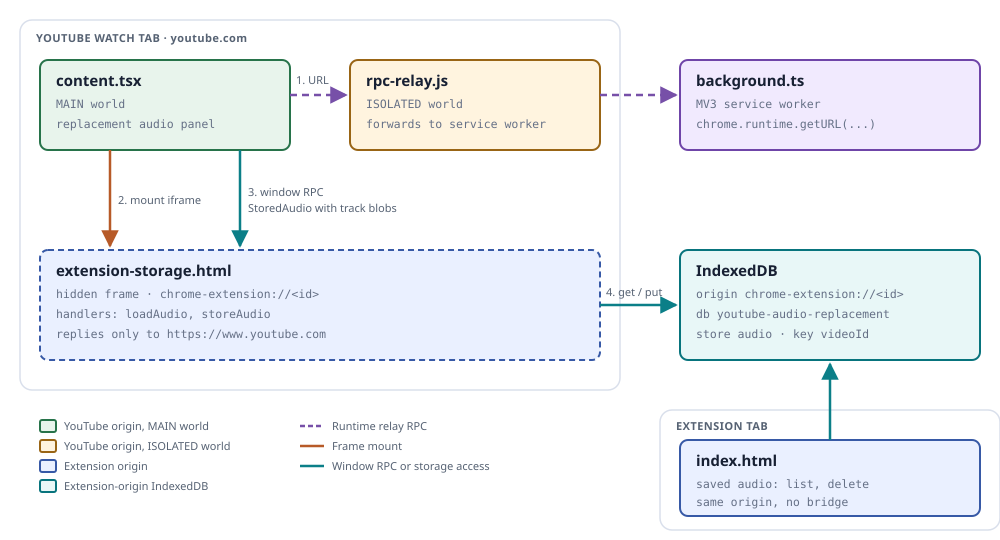

# Extension-Origin Storage

Replacement audio lives in IndexedDB under the extension origin. The watch page reaches it through a hidden extension frame, and the extension page opens it directly, so playback and saved-audio management share one store.

## Store Audio Under the Extension Origin

Origin, rather than tab or frame, decides which IndexedDB database code can open. If the watch page stored audio itself, the audio would land in `youtube.com` storage, which the extension page cannot read. The storage frame and the extension page both run under the extension origin, so they open the same database.

The watch page still owns playback state, such as which audio is selected and the mixer settings. Only the audio blobs move to the extension origin.

## Bridge the Watch Page Through a Hidden Frame

1. The MAIN-world script cannot call `chrome.runtime.getURL`, so it asks the service worker for the storage frame URL through the relay. This bootstrap request is the only storage step that uses the relay.
2. The script mounts the frame hidden and creates a window RPC client after the frame's load event. It does this once per page.
3. Loading and storing audio go over window RPC. The audio, including its track blobs, crosses by structured clone.
4. The frame reads with `get` by video ID and writes with `put`.

The frame exposes only load and store. It accepts messages only from its parent window and replies only to `https://www.youtube.com`. MAIN-world code could already use YouTube-origin storage, so the bridge changes where audio is stored, not what the watch page is trusted to do. The service worker sees only the URL request, never audio data.

## Access Storage Directly from Extension Pages

Code in an extension page is an ordinary same-origin client of the database. The saved-audio view lists and deletes stored audio directly, without a frame or RPC.

## References

- [Issue #17](https://github.com/hi-ogawa/youtube-audio-replacement/issues/17): the storage design.
- [Extension architecture](extension-architecture.md): the other execution contexts and transports.
